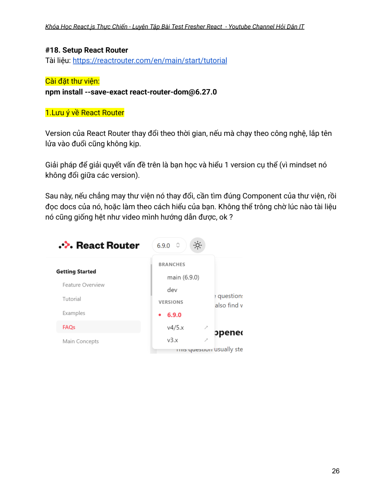
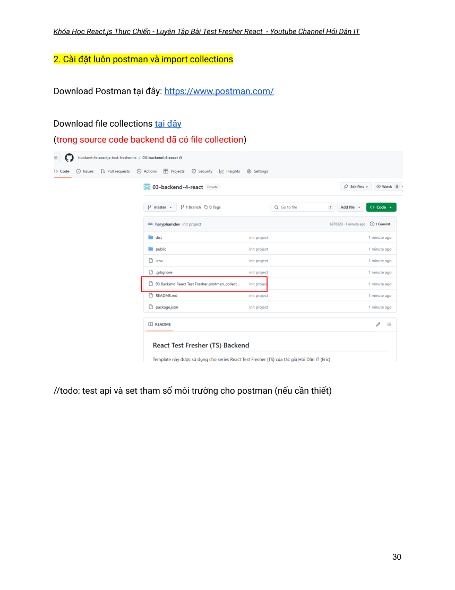

# React Test Fresher (TypeScript) — Giáo án trích xuất từ PDF

> **Nguồn:** Hỏi Dân IT / Eric; tài liệu 83 trang, version 1.0. Đây là bản chuyển đổi kỹ thuật từ PDF, KHÔNG phải bản chép lại nội dung video Udemy.
> **Độ trung thực:** Giữ nguyên ý/nội dung chữ trích xuất. Ngắt dòng, ký tự đặc biệt, code block và các hyperlink có thể không giống 100% PDF. Nếu có mâu thuẫn/thiếu hình, kiểm tra `react-test-fresher-ts.pdf` theo số PDF page.
> **Lưu ý:** Cảnh báo, lựa chọn version và chỉ dẫn trong giáo án phản ánh khóa học; không tự coi là khuyến nghị công nghệ/bảo mật hiện hành.

## Mục lục nhanh

- [Video #29 — Design Register Form (PDF trang 36)](#pdf-page-36)
- [Course Index](COURSE_INDEX.md)

<!-- pdf-page:1; printed-page:bìa -->

<a id="pdf-page-1"></a>

## PDF page 1

TÀI LIỆU KHÓA HỌC  
“React.js Thực Chiến - Luyện Tập Bài Test Fresher React”  

Tác giả: Hỏi Dân IT & Eric  

Version: 1.0  

Note cập nhật:  

Update tài liệu/Renew with React TypeScript

<!-- pdf-page:2; printed-page:1 -->

<a id="pdf-page-2"></a>

## PDF page 2 · Trang in 1

Hướng Dẫn Sử Dụng Udemy Dành Cho Người Mới Bắt Đầu                                   4  
Cách Hỗ Trợ/Support Trong Quá Trình Học (Bắt Buộc Xem)                                   5  
## Chapter 1: Bắt buộc xem - Không bỏ qua chương học này                                 8
### Video #1 — Hướng Dẫn Sử Dụng Khóa Học Hiệu Quả                                           8
### Video #2 — Tài liệu khóa học                                                              10
### Video #3 — Demo kết quả đạt được                                                             11
### Video #4 — Tại sao khóa học này ra đời ?                                                    13
### Video #5 + #6 — Về Tác giả                                                               14
## Chapter 2: Setup Environment                                                        15
### Video #7 — Chuyện Cài Đặt Công Cụ (Bắt Buộc Xem)                                          15
### Video #8 — Cài đặt Node.js                                                               17
### Video #9 — Cài đặt Visual Studio Code                                                      19
### Video #10 — Cấu hình Visual Studio Code                                                   19
### Video #11 — Tại sao mình dùng VScode ?                                                   20
### Video #12 — Cài đặt và sử dụng Git                                                        21
### Video #13 — Cài đặt Google Chrome                                                        22
## Chapter 3: React với TypeScript                                                      23
### Video #14 — Tổng quan về chapter                                                         23
### Video #15 — Lựa chọn công nghệ                                                          23
### Video #16 — Setup Dự Án Thực Hành                                                       24
### Video #17 — Cách mình Setup Dự Án Thực Hành (Extra)                                       25
### Video #18 — Setup React Router                                                           26
### Video #19 — Chia Layout và Cấu Trúc Project                                                 27
### Video #20 — Cài đặt MongoDB Compass                                                    28
### Video #21 — Tạo Tài Khoản MongoDB Atlas                                                  28
### Video #22 — Tạo Database cho dự án                                                       28
### Video #23 — Kiểm Tra Kết Nối Database                                                     28
### Video #24 — Kích hoạt dự án Backend                                                      29
### Video #25 — Cấu trúc Module Thực Hành (Extra)                                              31
## Chapter 4: Module Auth                                                             32
### Video #26 — Tổng quan về chapter                                                         32
### Video #27 — Cài đặt thư viện UI Antd - Ant Design                                             33
### Video #28 — Giới Thiệu Form Component                                                    34
### Video #29 — Bài tập Design Register Form                                                   35
### Video #30 — Axios và Axios Customize (Part 1)                                               36
### Video #31 — Axios và Axios Customize (Part 2)                                               38
### Video #32 — Bài tập chức năng Register                                                     38
### Video #33 — Debug Ứng Dụng React Chuyên Nghiệp (Extra)                                    38
### Video #34 — Bài tập Chức Năng Login                                                      39
### Video #35 — Access Token và Refresh Token (Extra)                                           40
### Video #36 — Store User Login with React Context                                             42
### Video #37 — Xử Lý F5 (Refresh page)                                                       43
### Video #38 — Xử lý Loading                                                               43

<!-- pdf-page:3; printed-page:2 -->

<a id="pdf-page-3"></a>

## PDF page 3 · Trang in 2

### Video #39 — Protected Page                                                              44
### Video #40 — Bài Tập Design Layout                                                        45
### Video #41 — Tổng kết về chapter                                                           45
## Chapter 5: Module Users                                                            46
### Video #42 — Tổng quan về chapter                                                         46
### Video #43 — Giới Thiệu Table Component                                                   46
### Video #44 — API Hiển Thị Danh Sách User                                                   47
### Video #45 — Bài Tập Hiển Thị Danh Sách User                                               47
### Video #46 — API Filter                                                                   48
### Video #47 — Bài Tập Filter Danh Sách User                                                  49
### Video #48 — Bài tập Sorter                                                               50
### Video #49 — Bài tập chức năng View Detail User                                              51
### Video #50 — Hiển Thị Avatar (Extra)                                                        51
### Video #51 — Bài tập chức năng Create User                                                  52
### Video #52 — Design Modal Upload File (Drag & Drop)                                          53
### Video #53 — Read File Excel                                                              54
### Video #54 — Bài tập Chức năng Import User                                                  55
### Video #55 — Download Sample File                                                        55
### Video #56 — Bài tập chức năng Export User (CSV)                                            56
### Video #57 — Bài tập chức năng Update User                                                 56
### Video #58 — Bài tập chức năng Delete User                                                  57
### Video #59 — Tổng kết về chapter                                                           57
## Chapter 6: Module Books                                                            58
### Video #60 — Tổng quan về chapter                                                         58
### Video #61 — Bài tập Hiển Thị/Filter/Sort Books                                                58
### Video #62 — Bài tập design chức năng xem chi tiết Book                                        59
### Video #63 — Hoàn thiện chức năng xem chi tiết Book                                           59
### Video #64 — Design Form Add New Book                                                    60
### Video #65 — Bài tập Upload File                                                           61
### Video #66 — Bài tập Create a New Book                                                     62
### Video #67 — Bài tập Update a Book                                                        63
### Video #68 — Bài tập Delete a Book & Export Data                                             63
### Video #69 — Bài tập Design Giao Diện Client (homepage)                                       64
### Video #70 — Bài Tập Hiển Thị HomePage                                                    65
### Video #71 — Bài tập Filter/Sorter HomePage                                                 65
### Video #72 — Bài tập Design View Detail Page (Part 1)                                          66
### Video #73 — Bài tập Design View Detail Page (Part 2)                                          67
### Video #74 — Thêm Loading Skeleton                                                       67
### Video #75 — Tổng kết về chapter                                                           68
## Chapter 7: Module Orders                                                            69
### Video #76 — Tổng quan về chapter                                                         69
### Video #77 — Bài tập Add/Remove Product                                                   69
### Video #78 — Bài Tập Lưu Data Giỏ Hàng                                                    69
### Video #79 — Bài Tập Hiển Thị Số Lượng Giỏ Hàng                                            70

<!-- pdf-page:4; printed-page:3 -->

<a id="pdf-page-4"></a>

## PDF page 4 · Trang in 3

### Video #80 — Bài Tập Preview Cart                                                         70
### Video #81 — Bài tập Order Page                                                           71
### Video #82 — Bài tập Checkout Page                                                        72
### Video #83 — API Create An Order                                                          73
### Video #84 — Bài tập View Order History                                                     73
### Video #85 — Bài tập Update Current User                                                    74
### Video #86 — Bài Tập Display Order page + API Dashboard                                      75
### Video #87 — Các bugs còn tồn đọng                                                        76
## Chapter 8: Triển Khai Dự Án Thực Tế                                                  77
### Video #88 — Mô hình triển khai                                                            77
### Video #89 — Tạo Tài Khoản Render                                                        78
### Video #90 — Triển Khai Backend với Render                                                 79
### Video #91 — 1 Tạo Tài Khoản Vercel                                                        80
### Video #91 — 2 Link Vercel tới Github                                                        80
### Video #92 — Triển khai Frontend với Vercel                                                  80
### Video #93 — Chuyện Học 1 Khóa Học                                                       82
### Video #94 — Level Fresher là level như thế nào ?                                              82
### Video #95 — Học gì tiếp đây ?                                                             82

<!-- pdf-page:5; printed-page:4 -->

<a id="pdf-page-5"></a>

## PDF page 5 · Trang in 4

Hướng Dẫn Sử Dụng Udemy Dành Cho Người Mới Bắt Đầu  

Tài liệu hướng dẫn chi tiết xem tại đây  

Mục tiêu: hướng dẫn sử dụng các tính năng chủ yếu của Udemy, hỗ trợ việc học tập hiệu  
quả hơn, dành cho người lần đầu tiên sử dụng nền tảng Udemy.  

**1. Các tính năng cơ bản**
    ● Hiển thị giao diện ngôn ngữ tiếng anh/tiếng việt  

    ● Khóa học của tôi nằm ở đâu ? (my learning - kiểm tra các tabs)  

    ●  Trình phát video  

    ● Điều chỉnh chất lượng, tốc độ video  

    ● Download tài liệu (nếu có)  

**2.Các tính năng khác**

    ● Bạn có thể sử dụng Udemy App trên mobile. Download tại đây  

    ● Q/A, Notes, Announcements

<!-- pdf-page:6; printed-page:5 -->

<a id="pdf-page-6"></a>

## PDF page 6 · Trang in 5

Cách Hỗ Trợ/Support Trong Quá Trình Học (Bắt Buộc Xem)  

Mục đích:  
    ●  Giải đáp thắc mắc của học viên liên quan về nội dung khóa học  

    ● Hỗ trợ gỡ lỗi (fix bug) trong quá trình thực hành theo video hướng dẫn  

**1.Tính năng Q&A (Hỏi/Đáp)**
Sử dụng tính năng này khi bạn cần giải đáp thắc mắc & hỗ trợ trong quá trình thực hành,  
với các ưu điểm vượt trội sau:  
    ● Bảo vệ sự riêng tư của bạn (chỉ hiển thị tên tài khoản Udemy)  

    ● Hỗ trợ upload hình ảnh, gõ code… giao diện trực quan, dễ theo dõi, tránh tình  
       trạng trôi tin nhắn (so với cách chat text)  

    ● Hỗ trợ lọc/filter câu hỏi, xem lịch sử các câu hỏi đã đặt ứng với video đang xem  

    ● Cung cấp ngữ cảnh (gặp vấn đề tại video nào), như vậy nó sẽ rõ ràng & giải quyết  
     nhanh hơn  

**2. Hướng dẫn cách đặt câu hỏi**

Trước khi đặt câu hỏi, bạn nên lọc câu hỏi theo video, mục đích là kiểm tra vấn đề bạn  
hỏi, đã có người khác hỏi hay chưa, giúp bạn tiết kiệm thời gian hơn.  

Các nguyên tắc khi đặt câu hỏi:  
    ● Đặt câu hỏi theo video bạn thắc mắc/cần hỗ trợ  

    ● Câu hỏi cần rõ ràng, tường minh, tránh nêu vấn đề chung chung, không cụ thể.

<!-- pdf-page:7; printed-page:6 -->

<a id="pdf-page-7"></a>

## PDF page 7 · Trang in 6

Minh họa cách đặt câu hỏi:  

Bước 1: Chọn bài giảng bạn “gặp vấn đề” cần hỗ trợ  

Bước 2: Duyệt qua danh sách câu hỏi ứng với video đang xem (nếu có), vì nếu như đã có  
vấn đề bạn gặp phải, sẽ giúp bạn tiết kiệm thời gian.  

Bước 3: Đặt câu hỏi mới  
    ● Đặt tiêu đề: nếu ngắn gọn (đặt tên) cho vấn đề bạn muốn hỏi  

    ●  Viết nội dung chi tiết: miêu tả cụ thể vấn đề gặp phải  

     Hướng dẫn: chèn link (ví dụ google drive), chèn ảnh và gõ code.  
     Sửa (update) câu hỏi nếu cần thiết.  

Gợi ý các mẫu đặt câu hỏi:  
Mẫu 1 – Khi gặp lỗi code:  
Tôi đang học tới [đoạn nào trong video], gặp vấn đề [Mô tả ngắn về lỗi].  

Tôi đã thử [Các bước đã làm để xử lý], nhưng kết quả là [Thông báo lỗi hoặc tình trạng  
xảy ra].  

Đây là đoạn code/hình ảnh minh họa:  
[Đoạn code ngắn hoặc ảnh chụp màn hình]  

Mẫu 2 - Hỏi kỹ năng:  
Trong bài [Tên bài hoặc chủ đề], tôi thấy phương pháp/kỹ thuật [Tên phương pháp] rất  
hay, nhưng chưa rõ cách áp dụng trong [Ngữ cảnh thực tế của bản thân].  

Tôi mong giảng viên/anh chị có thể cho thêm một ví dụ minh họa cụ thể để tôi dễ hình  
dung hơn.

<!-- pdf-page:8; printed-page:7 -->

<a id="pdf-page-8"></a>

## PDF page 8 · Trang in 7

**3. Hướng dẫn cách xem câu trả lời**
Udemy sẽ hiển thị thông báo trong tài khoản Udemy, và gửi email khi có phản hồi.  

Thông thường, thời gian phản hồi câu hỏi là 24h (ngày lễ, thứ 7, chủ nhật có thể lâu hơn).  
Tối đa thời gian nhận phản hồi là 02 ngày làm việc (2 business days)  

Khi mở email, cần kiểm tra từ inbox (primary), update, social, spam…  

`//todo: hướng dẫn kéo thả email vào primary (no-reply@e.udemymail.com)`

(Mỗi lần enroll, sẽ có email tới từ: hello@alerts.udemy.com)  

**4. Hướng dẫn cách nhận thông báo (nếu có)**

Cấu hình tại đây  

**5. Kênh liên hệ giảng viên trên Udemy (message)**

Profile giảng viên: https://www.udemy.com/user/eric-7039/

<!-- pdf-page:9; printed-page:8 -->

<a id="pdf-page-9"></a>

## PDF page 9 · Trang in 8

## Chapter 1: Bắt buộc xem - Không bỏ qua chương học này
Hướng dẫn sử dụng khóa học hiệu quả  

### Video #1 — Hướng Dẫn Sử Dụng Khóa Học Hiệu Quả

Bạn vui lòng "xem video lần lượt" theo trình tự. Vì khóa học như 1 dòng chảy, video sau  
sẽ kế thừa lại kết quả của video trước đó.  

**1. Dành cho học viên "có ít thời gian"**
Nếu bạn vội, cần học nhanh, hoặc "bạn đã biết rồi", thì "vẫn xem video, cơ mà không cần  
code theo".  

Lưu ý: vẫn xem qua tài liệu khóa học để biết "video hướng dẫn gì".  
Đã "Không xem video", thì cần "đọc giáo án".  

Có như vậy mới biết khóa học nó làm cái gì.  

**2. Dành cho học viên "thông thường"**
Nguyên tắc:  
- Xem video lần lượt  
- Xem video kết hợp với giáo án. Bạn không cần take note, vì những điều quan trọng đã  
có trong giáo án  

- Bạn vui lòng code theo video.  
Nếu bạn "code theo ý bạn", vui lòng "không hỏi khi có bugs".  

Câu chuyện này giống như việc bạn đi khám bệnh, nhưng không tin lời bác sĩ  
=> Nếu bạn giỏi, bạn làm luôn bác sĩ, còn đi khám bệnh làm gì.  

- Bạn có thể "code theo ý bạn muốn", sau khi "đã kết thúc khóa học"  

- Nếu bạn có thắc mắc (hoặc có ý tưởng/nhận thấy bugs), take note lại, bạn hỏi, rồi mình  
giải đáp.  
Chứ không phải là "tự ý làm theo điều các bạn muốn".  
Vì đa phần, các bugs trong khóa học mình đã fix hết rồi.  

Nên là yên tâm để học theo bạn nhé.

<!-- pdf-page:10; printed-page:9 -->

<a id="pdf-page-10"></a>

## PDF page 10 · Trang in 9

**3. Về cách code.**

Bạn vui lòng code theo video, từ cách đặt tên biến, hàm. Vì mình đã tuân theo  
"convention tối thiểu" khi bạn đi làm đấy  

**4. Về bài tập thực hành**
Đối với bài tập thực hành, bạn cứ code theo cách bạn hiểu, và kết hợp với "search  
Google, stackoverflow..."  
KHÔNG DÙNG CHATGPT. Đây giống kiểu chưa học "phép tính", mà đã "dùng máy tính".  

Nên nhớ 1 điều, trước 2023, không có chat gpt, thì mình học như thế nào ?  
Khi bạn đã đi làm, bạn có quyền dùng cái gì bạn thích, còn với beginner, hãy biết say NO  
với CHAT GPT.  

tương tự bạn dạy con bạn:  
học lớp cấp 1: không chịu học tính nhầm => đưa luôn máy tính cho nó. Rời máy tính ra,  
là không biết làm phép tính  

còn với học sinh cấp 2, 3 : dùng máy tính tùy thích

<!-- pdf-page:11; printed-page:10 -->

<a id="pdf-page-11"></a>

## PDF page 11 · Trang in 10

### Video #2 — Tài liệu khóa học
`//todo`

<!-- pdf-page:12; printed-page:11 -->

<a id="pdf-page-12"></a>

## PDF page 12 · Trang in 11

### Video #3 — Demo kết quả đạt được

Video demo : https://youtu.be/z5ywlBpVusw  

**1.Trọng tâm của khóa học**
      -  100% code sử dụng TypeScript. Giúp code nhanh hơn và hạn chế bug so với  
      JavaScript (version cũ), đồng thời đáp ứng nhu cầu tuyển dụng của công ty.  

      -  Đây là dự án thực hành (project cuối khóa).  
     Nếu như rằng, bạn đi học trung tâm, luôn có dự án thực hành/thực chiến cuối  
      khóa học, thì đây chính là cơ hội để cho bạn được “thực hành” một dự án với  
      React sử dụng công cụ TypeScript  

      -  Backend dự án này sẽ được cung cấp sẵn (bạn không cần viết backend), chỉ dùng  
      và không sửa đổi.  
     Backend này đảm bảo yêu cầu trong thực tế, ví dụ như cơ chế JWT - JSON Web  
      Token (access token, refresh token…)  

      -  Khóa học này chính là thời gian cho bạn chuyển hóa kiến thức, có thể kể đến như  
       kiến thức React, React Router và việc kết hợp render giao diện với dữ liệu lấy từ  
      API backend.  

      -  Sử dụng Ant Design để tiết kiệm thời gian CSS và viết Component React.  
     Áp dụng Pro Component (Ant Design Pro), phục vụ đắc lực cho giao diện Admin  

**2. Công nghệ sử dụng**
Dự án thực hành: Website bán sách có tích hợp hình thức thanh toán (VNPAY)  

Frontend:  
      -  React 18, React Router 6 sử dụng với TypeScript  
      -  Cấu hình dự án React sử dụng React Vite (mô hình CSR - client side rendering)  
       với TypeScript từ số 0  
      -  Design giao diện với Antd (Ant Design) kết hợp với Pro Component (Ant Design  
      Pro) giúp thiết kế giao diện nhanh hơn và tiết kiệm thời gian CSS.

<!-- pdf-page:13; printed-page:12 -->

<a id="pdf-page-13"></a>

## PDF page 13 · Trang in 12

Backend (chính): Nestjs được cung cấp sẵn, chỉ dùng và không sửa đổi.  

Backend (phụ): được cung cấp code backend mẫu (có thể sửa đổi) hướng dẫn tích hợp  
ví VNPay dùng để thanh toán qua tài khoản ngân hàng.  

Lưu ý: không học code backend trong khóa học này, bạn không cần code logic backend,  
backend được cung cấp sẵn, chỉ việc sử dụng (có giải thích logic để tích hợp với  
Frontend)  

Database : MongoDB dùng miễn phí với MongoDB Atlas  

**3. Học viên nào có thể học ?**

Khóa học này là khóa học thứ 3 trong lộ trình React của Hỏi Dân IT, sau khi bạn đã học  
xong khóa học React Cơ Bản và khóa học React Pro Typescript Portfolio  

Vì vậy, học viên cần trang bị các kiến thức sau trước khi theo học:  

Yêu cầu 1: Biết React.js làm website sử dụng Typescript  
Nếu bạn chưa biết gì về React.js làm website, tham khảo tại đây  
Nếu bạn chưa biết code React.js với TypeScript, tham khảo tại đây  

Yêu cầu 2: Biết sử dụng Git để quản lý mã nguồn  

Kiến thức về Git sẽ giúp bạn 2 việc quan trọng:  
      -  Có khả năng backup code của chính bạn, tránh trường hợp máy tính bị hư hỏng,  
     dẫn tới mất code. Ngoài ra, khi cần mình support, bạn có thể gửi project cho mình  

      -  Bạn có khả năng sử dụng code mà khóa học cung cấp  

Nếu bạn chưa biết gì về Git, xem khóa học Git miễn phí tại đây  
Khóa học Git trả phí, tham khảo tại đây

<!-- pdf-page:14; printed-page:13 -->

<a id="pdf-page-14"></a>

## PDF page 14 · Trang in 13

### Video #4 — Tại sao khóa học này ra đời ?

**1.Các vấn đề được giải quyết trong khóa học**

      -  Tạo cơ hội cho bạn “thực hành” React (với backend được cung cấp sẵn)  
     Lưu ý: đa phần các video trong khóa học là video “định hướng”, phần còn lại bạn  
      cần thực hành.  
     Yên tâm là bạn sẽ được cung cấp source code theo từng video thực hành (nếu  
      cần)  

     Đây không phải là khóa học hướng dẫn bạn từng dòng code một. Vì đơn giản, nó  
        là khóa học thực hành.  
     Hãy tưởng tượng bạn đi học trung tâm, bạn có dự án thực hành cuối khóa, khóa  
     học này có ý nghĩa tương tự như vậy  

      -  Đưa ra yêu cầu (giả lập) trong thực tế mà các công ty có thể trông chờ.  

**2. Yêu cầu để học khóa học này**
Yêu cầu 1: Biết React.js làm website Typescript  
Nếu bạn chưa biết gì về React.js làm website, tham khảo tại đây  
Nếu bạn chưa biết code React.js với TypeScript, tham khảo tại đây  

Yêu cầu 2: Biết sử dụng Git để quản lý mã nguồn  

Kiến thức về Git sẽ giúp bạn 2 việc quan trọng:  
      -  Có khả năng backup code của chính bạn, tránh trường hợp máy tính bị hư hỏng,  
     dẫn tới mất code. Ngoài ra, khi cần mình support, bạn có thể gửi project cho mình  

      -  Bạn có khả năng sử dụng code mà khóa học cung cấp  

Nếu bạn chưa biết gì về Git, xem khóa học Git miễn phí tại đây  
Khóa học Git trả phí, tham khảo tại đây  

**3. Khóa học này nằm ở đâu trong lộ trình Frontend của tác giả Hỏi Dân IT**

Khóa học này là khóa học thứ 3 , sau khi bạn đã học xong khóa học React Cơ Bản và  
khóa học React Pro Typescript Portfolio  

Chi tiết về lộ trình Frontend React của tác giả Hỏi Dân IT, tham khảo tại đây.

<!-- pdf-page:15; printed-page:14 -->

<a id="pdf-page-15"></a>

## PDF page 15 · Trang in 14

### Video #5 + #6 — Về Tác giả
Về tác giả:  

Mọi thông tin về Tác giả Hỏi Dân IT, các bạn có thể tìm kiếm tại đây:  

Website chính thức: https://hoidanit.vn/  

Youtube “Hỏi Dân IT” : https://www.youtube.com/@hoidanit  

Tiktok “Hỏi Dân IT” : https://www.tiktok.com/@hoidanit  

Fanpage “Hỏi Dân IT” : https://www.facebook.com/askITwithERIC/  

Udemy Hỏi Dân IT: https://www.udemy.com/user/eric-7039/  

Nếu bạn muốn nói chuyện với mình (giao lưu trao đổi võ công :v), có thể xem mình  
livestream trực tiếp tối thứ 2 hàng tuần trên Youtube Hỏi Dân IT

<!-- pdf-page:16; printed-page:15 -->

<a id="pdf-page-16"></a>

## PDF page 16 · Trang in 15

## Chapter 2: Setup Environment
Cài đặt & chuẩn bị môi trường thực hiện dự án  

### Video #7 — Chuyện Cài Đặt Công Cụ (Bắt Buộc Xem)

**1.Mục đích**
Chương học này sẽ hướng dẫn chi tiết cách cài đặt các công cụ cần thiết để phục vụ  
cho khóa học. Vì vậy, bạn vui lòng không bỏ qua video nào, xem lần lượt theo thứ tự  

Có 2 sai lầm mà các bạn hay gặp phải, đặc biệt là những bạn “đã biết 1 chút”  

Sai lầm 1: Bỏ qua các video cài đặt công cụ vì bạn cho rằng bạn “đã biết rồi”  

Hãy nhớ rằng, cài công cụ là 1 phần, đang còn phải “cấu hình” nó nữa.  

Khóa học được sinh ra, và đã tối ưu. Bạn chỉ dành 5 tới 10 phút để xem video, đổi lại tiết  
kiệm cho bạn cả giờ đồng hồ ngồi mò mẫm.  

Sai lầm 2: Không quan tâm tới version của phần mềm  

Khi thực hiện khóa học, bạn vui lòng download và cài đặt version phần mềm giống như  
video. Điều này sẽ đảm bảo môi trường thực thi code là giống nhau. (hạn chế tối đa bug  
có thể xảy ra)  

**2. Version Phần Mềm theo thời gian**

Bạn đừng sợ phần mềm (công cụ) nó thay đổi version, hay thậm chí là “chê bai” version  
cũ. Vì vốn dĩ, công nghệ nó là vậy, luôn thay đổi theo thời gian.  

Bạn yêu cầu “version mới nhất” cho cái bạn học, mình đã làm điều đó tại thời điểm quay  
video khóa học, tuy nhiên, sẽ là cố định 1 version.  

Lý do: công nghệ sẽ cập nhật theo thời gian. Cho dù bạn muốn hay không, hoặc thậm  
chí lắp tên lửa vào đít, đuổi cũng không kịp.

<!-- pdf-page:17; printed-page:16 -->

<a id="pdf-page-17"></a>

## PDF page 17 · Trang in 16

Điều bạn cần làm là: học 1 version, và quan trọng hơn, là bạn học, bạn cần hiểu nó  

Sau đấy, nếu cần thiết, bạn học version mới hơn. Điểm khác biệt ở đây, là khi học version  
mới, bạn không phải là người bắt đầu từ số 0 (do đã có base từ version cũ)  

Chỉ không học version cũ khi và chỉ khi: sản phẩm của version cũ không dùng được  

Đấy là lý do tại sao các khóa học của mình, khi học xong, mình mới hướng dẫn nâng cấp  
version.

<!-- pdf-page:18; printed-page:17 -->

<a id="pdf-page-18"></a>

## PDF page 18 · Trang in 17

### Video #8 — Cài đặt Node.js

Tài liệu: https://nodejs.org/en  

**1.Nodejs là gì ?**
Nodejs không phải là thư viện (library), không phải framework của javascript.  

Nodejs là môi trường để bạn thực thi code javascript, tại browser và server.  

Bạn học React (viết bằng Javascript), nên bạn cần Nodejs để có thể chạy được nó (code  
javascript)  

Điều này tương tự với:  

Bạn học cách sử dụng Microsoft Excel (react)  
Bạn cần cài hệ điều hành Windows để có thể học nó (nodejs)  

**2. Cài đặt Nodejs**
Sai lầm của beginners, là không quan tới tới version của phần mềm. Nên nhớ, công nghệ  
nó thay đổi theo thời gian, vì vậy, để hạn chế tối đa lỗi tối đa, bạn nên dùng version phần  
mềm như khóa học hướng dẫn.  

Điều này tương tự với:  
Bạn đang chơi 1 con game rất ngon trên Windows 7, bạn vác lên Windows 10 để chạy,  
có điều gì để đảm bảo rằng “sẽ không có lỗi xảy ra” ?  

Trong khóa học này, mình sử dụng version Node.js là 20.14.0.  

Vì vậy, để hạn chế tối đa lỗi có thể xảy ra, bạn vui lòng cài đặt chính xác version nodejs ở  
trên  

Khi code giống nhau, môi trường thực thi code giống nhau (version nodejs), thì rất hiếm  
khi lỗi xảy ra.

<!-- pdf-page:19; printed-page:18 -->

<a id="pdf-page-19"></a>

## PDF page 19 · Trang in 18

Link tải nodejs v20.14.0:  
https://nodejs.org/download/release/v20.14.0/  

Sau khi cài đặt xong, kiểm tra bằng cách gõ câu lệnh:  

node -v  

**3. Trường hợp dùng nhiều version Nodejs**
//áp dụng cho windows  
https://github.com/coreybutler/nvm-windows  

Video hướng dẫn cài nvm cho window, xem tại đây  

//áp dụng cho macos  
Video hướng dẫn cài nvm cho mac, xem tại đây  

https://dev.to/ajeetraina/how-to-install-and-configure-nvm-on-mac-os-5fgi

<!-- pdf-page:20; printed-page:19 -->

<a id="pdf-page-20"></a>

## PDF page 20 · Trang in 19

### Video #9 — Cài đặt Visual Studio Code
Công cụ code trong dự án sử dụng VSCode, 1 Editor hoàn toàn miễn phí  

Link download:  
https://code.visualstudio.com/download  

### Video #10 — Cấu hình Visual Studio Code
**1. Format Code**
Setup Format on Save  
Mục đích: Mỗi lần nhấn Ctrl + S , code sẽ được auto format trông cho đẹp/dễ nhìn  

**2. Cài đặt Extensions**

Lưu ý: off các extension như eslint, prettier … để tránh xung đột  
Fact: đi làm, người ta cấu hình eslint, prettier..thông qua code, vì mỗi 1 dự án (1 khách  
hàng 1 yêu cầu), cài global qua extension thì cái nào cũng giống cái nào  

Đồng thời, với rule trên sẽ đảm bảo mọi thành viên trong team sẽ có cấu hình giống  
nhau  

Các extensions cài đặt thêm:  
- Code Spell Checker : hỗ trợ check chính tả khi đặt tên tiếng anh  

- Auto Complete Tag : hỗ trợ code nhanh HTML

<!-- pdf-page:21; printed-page:20 -->

<a id="pdf-page-21"></a>

## PDF page 21 · Trang in 20

### Video #11 — Tại sao mình dùng VScode ?

Có rất nhiều IDE hỗ trợ bạn code React (Javascript):  
      -  Visual Studio Code (gọi tắt là VSCode)  
      -  WebStorm  
      -  Sublime Text  
      -  Notepad, Notepad ++ 😂  

IDE/Editor thực chất là công cụ code, giúp gợi ý code và phát hiện lỗi  
=> dùng công cụ code nào mà bạn "thoải mái nhất"  

Mình chọn VScode vì:  
- miễn phí (nếu bạn code Frontend thì chắc chắn bạn sẽ thích)  
- có gợi ý code và phát hiện lỗi  
- theme dark :v  
- hỗ trợ git out-of-the-box  
- support mạnh mẽ cho "frontend" => tức là 1 IDE cho cả frontend/backend  

Trong khóa học này, chỉ cần bạn code giống mình, dùng IDE nào không quan trọng,  
điều quan trọng, chính là cách chúng ta code ra làm sao :v  

Recommend: dùng VScode, để đảm bảo bạn và mình giống nhau 100%, từ coding cho  
tới debug :v  

Yên tâm 1 điều là: điều quan trọng nhất chính là khả năng bạn “tư duy” (mindset), bạn  
có thể dùng những điều học được, để áp dụng sang IDE bạn thích.  

Fact: mình đã từng rơi vào công ty (khá to), cơ mà không mua license bản quyền phần  
mềm (trong khi không cho dùng crack)  
=> bắt buộc phải dùng các công cụ free @@

<!-- pdf-page:22; printed-page:21 -->

<a id="pdf-page-22"></a>

## PDF page 22 · Trang in 21

### Video #12 — Cài đặt và sử dụng Git
- Nếu bạn chưa biết gì về Git, xem nhanh tại đây  

- Sử dụng Git theo nguyên tắc:  
**1. Học xong video nào, commit đẩy lên Github/Gitlab**
=> tạo cơ hội để thực hành câu lệnh của Git, ví dụ:  
git add  
git commit  
git push...  

**2. Git là công cụ "mặc định bạn phải biết" khi đi làm phần mềm**
=> điều 1 ở trên giúp bạn thực hành  

**3. Thói quen học xong video nào, đẩy code lên Git, giúp bạn tạo ra bản "backup" cho**
project của bạn  

Ví dụ máy tính bạn bị hỏng đột xuất/bị mất  
=> vẫn còn code, chỉ cần pull về code tiếp mà không phải code từ đầu.  

**4. Trong trường hợp bạn bị bug**
=> bạn có thể gửi link github/gitlab cho mình xem => support fix bug  

=> Mục đích sử dụng git ở đây là : backup code + thực hành công cụ đi làm mà bạn  
"phải biết" nếu muốn đi thực tập/đi làm.

<!-- pdf-page:23; printed-page:22 -->

<a id="pdf-page-23"></a>

## PDF page 23 · Trang in 22

### Video #13 — Cài đặt Google Chrome

Ở đây, sử dụng google chrome vì nó là ứng dụng phổ biến nhất (trình duyệt web được  
dùng nhiều nhất)  

Bạn nên dùng Google Chrome (thay vì Firefox/Edge…) để đảm bảo rằng thao tác sử  
dụng giữa bạn và mình là giống nhau (tránh gây khó khăn không cần thiết)  

Lưu ý: sử dụng version tiếng anh  
=> change language  

Mục tiêu:  
      -  Sử dụng Google Chrome để chạy ứng dụng web  

      -  Ngôn ngữ hiển thị là Tiếng Anh  

      -  Set default app là google chrome (nếu nó mở app, thì chạy với google chrome)  

    Xem hướng dẫn setup default app cho windows tại đây

<!-- pdf-page:24; printed-page:23 -->

<a id="pdf-page-24"></a>

## PDF page 24 · Trang in 23

## Chapter 3: React với TypeScript
Sử dụng React sử dụng ngôn ngữ TypeScript từ số 0  

### Video #14 — Tổng quan về chapter
`//todo`

### Video #15 — Lựa chọn công nghệ

**1. Javascript hay Typescript ?**
Version cũ mình dùng JavaScript. Version mới, mình khuyến khích sử dụng Typescript  
Lý do 1: được support tối hơn, đặc biệt trong việc phát hiểu lỗi (bug) khi gõ code  
Lý do 2: yêu cầu của công ty ngày càng tăng cao, và dùng Typescript là điều bắt buộc  

**2. CRA (create-react-app) hay Vite**
Tính tới thời điểm 2025, create-react-app is dead. Và nếu muốn sử dụng React với mô  
hình CSR (client side rendering), sử dụng Vite  

**3. Manage State’s React**
Version Javascript (cũ), mình sử dụng React Toolkit  

Version Typescript (mới), mình sử dụng React Context.  
Lý do 1: đơn giản và hạn chế setup phức tạp như là cách làm với Redux  
Lý do 2: React hiện đại (ví dụ Next.js), không bắt buộc phải dùng Redux  
Lý do 3: Mình đã có khóa học React State Manager để hướng dẫn về Redux  

**4. Responsive layout**

Để tạo nhanh layout, mình sử dụng Antd thay vì Bootstrap.  

Lý do : khóa học React Ultimate (react cơ bản), mình đã dùng antd. Vì vậy, khóa học này  
sẽ kế thừa và phát triển thêm

<!-- pdf-page:25; printed-page:24 -->

<a id="pdf-page-25"></a>

## PDF page 25 · Trang in 24

### Video #16 — Setup Dự Án Thực Hành

**1.Chuẩn bị**
Đảm bảo rằng bạn đã cài đặt Git và Node.js (version 20.14.0)  
Chưa biết dùng git, học ngay và luôn tại đây  

Bạn vui lòng sử dụng chính xác nodejs v20.14.0 để hạn chế tối đa lỗi xảy ra  
(mình đã giải thích tại video #8)  

**2.Cài đặt dự án thực hành**
Lưu ý : đường dẫn nơi lưu dự án thực hành, không nên đặt tên tiếng việt để hạn chế lỗi  
các bạn nhé  

Ví dụ: D:/dự án/react-fresher-typescript => thay bằng: D:/du-an/react-fresher-typescript  
Bước 1: Download source code tại đây  

Bước 2: cài đặt thư viện cần thiết  
npm i  

Lưu ý về warning/error tại terminal  

Bước 3: chạy dự án  

npm start (hoặc câu lệnh : npm run dev)  

**3.Viết Hello World**
`//todo`
Rename app => layout, đồng thời, remove css

<!-- pdf-page:26; printed-page:25 -->

<a id="pdf-page-26"></a>

## PDF page 26 · Trang in 25

### Video #17 — Cách mình Setup Dự Án Thực Hành (Extra)

Lưu ý, bạn vui lòng không làm theo video này.  

Mục đích mình làm video này, để thỏa mãn tính tò mò của nhiều bạn.  

Bạn chỉ làm như video này, khi đã có khả năng tự fix bug và đọc tài liệu, cũng như đã  
học xong khóa học này rồi.  

Bạn vui lòng thực hành khóa học bằng cái tải source code mình cung cấp tại #16  

Nếu như bạn tự ý code “theo cách bạn hiểu” và không sử dụng source code tại #16  
mình sẽ không hỗ trợ support khi có lỗi xảy ra  

Tài liệu: https://vite.dev/guide/  

//hướng dẫn cách đẩy code lên github/gitlab của chính bạn  
Nếu bạn chưa biết gì về Git, học ngay và luôn tại đây  

Bước 1: Tạo repository trên github/gitlab  

Bước 2: Đẩy dự án lên repository vừa tạo  
git add .  
git commit -m "init project"  

https://stackoverflow.com/questions/2432764/how-do-i-change-the-uri-url-for-a-remote  
-git-repository  

git remote set-url origin new.git.url/here  

git push origin master  

Bước 3: Minh họa khi code xong 1 video, chỉ cần sử dụng 3 câu lệnh bên dưới  
git add .  
git commit  
git push

<!-- pdf-page:27; printed-page:26 -->

<a id="pdf-page-27"></a>

## PDF page 27 · Trang in 26

### Video #18 — Setup React Router
Tài liệu: https://reactrouter.com/en/main/start/tutorial  

Cài đặt thư viện:  
npm install --save-exact react-router-dom@6.27.0  

**1.Lưu ý về React Router**

Version của React Router thay đổi theo thời gian, nếu mà chạy theo công nghệ, lắp tên  
lửa vào đuổi cũng không kịp.  

Giải pháp để giải quyết vấn đề trên là bạn học và hiểu 1 version cụ thể (vì mindset nó  
không đổi giữa các version).  

Sau này, nếu chẳng may thư viện nó thay đổi, cần tìm đúng Component của thư viện, rồi  
đọc docs của nó, hoặc làm theo cách hiểu của bạn. Không thể trông chờ lúc nào tài liệu  
nó cũng giống hệt như video mình hướng dẫn được, ok ?

> **Trang có hình/screenshot:** 


<!-- pdf-page:28; printed-page:27 -->

<a id="pdf-page-28"></a>

## PDF page 28 · Trang in 27

### Video #19 — Chia Layout và Cấu Trúc Project

**1.Chia layout**
`//todo`
login/register/home/book  

npm i --save-exact sass@1.80.4  
https://stackoverflow.com/a/79003101  

**2. Setup TypeScript Absolute Path**

Bước 1: cấu hình Vite  
npm i --save-exact --save-dev vite-tsconfig-paths@5.0.1  

https://stackoverflow.com/questions/68241263/absolute-path-not-working-in-vite-proje  
ct-react-ts  

https://github.com/aleclarson/vite-tsconfig-paths  

Bước 2: khai báo Typescript baseUrl và path  

Về typescript path: https://www.typescriptlang.org/tsconfig/#paths  

Bước 3: test import

<!-- pdf-page:29; printed-page:28 -->

<a id="pdf-page-29"></a>

## PDF page 29 · Trang in 28

### Video #20 — Cài đặt MongoDB Compass

MongoDB Compass không phải là database. Nó chỉ đơn thuần là một phần mềm cung  
cấp giao diện, giúp bạn thao tác với database (MongoDB)  

Database của khóa học sẽ được tạo tại các video tiếp theo (lưu trữ trên cloud)  

Link download: https://www.mongodb.com/try/download/compass  

### Video #21 — Tạo Tài Khoản MongoDB Atlas
Link đăng ký tài khoản MongoDB Atlas (miễn phí)  
https://www.mongodb.com/cloud/atlas/register  

### Video #22 — Tạo Database cho dự án
Lưu ý check allow anywhere  

Lưu lại thông tin kết nối tới database  

### Video #23 — Kiểm Tra Kết Nối Database
Công cụ: phần mềm Mongodb Compass  

Lưu lại connection để tiện sử dụng

<!-- pdf-page:30; printed-page:29 -->

<a id="pdf-page-30"></a>

## PDF page 30 · Trang in 29

### Video #24 — Kích hoạt dự án Backend

Lưu ý: backend này chỉ sử dụng và không sửa đổi.  

Bạn nào quan tâm về backend này mình viết như thế nào, tham khảo khóa học backend  

Nestjs của Hỏi Dân IT tại đây  

**1. Cài đặt backend**

Bước 1: download source code backend tại đây  

Bước 2: Cài đặt các thư viện cần thiết  

npm install --omit=dev  

Bước 3: update file .env  

Cập nhật tham số MONGO_DB_URL  

Bước 4: Chạy dự án thực hành  

npm start / npm run dev  

Bước 5: Test ứng dụng, truy cập: http://localhost:8080/

<!-- pdf-page:31; printed-page:30 -->

<a id="pdf-page-31"></a>

## PDF page 31 · Trang in 30

**2. Cài đặt luôn postman và import collections**

Download Postman tại đây: https://www.postman.com/  

Download file collections tại đây  

(trong source code backend đã có file collection)  

`//todo: test api và set tham số môi trường cho postman (nếu cần thiết)`

> **Trang có hình/screenshot:** 


<!-- pdf-page:32; printed-page:31 -->

<a id="pdf-page-32"></a>

## PDF page 32 · Trang in 31

### Video #25 — Cấu trúc Module Thực Hành (Extra)

Dự án thực hành được chia thành các module riêng biệt, tương ứng với các chức năng  
website xây dựng.  

Đối tượng sử dụng hệ thống (actor) gồm 2 loại chính: user (người dùng bình thường) và  
admin (người quản trị).  

Như vậy, các chức năng chính được xây dựng là:  
      -  Module Auth (authentication và authorization) :  
     + user login/register  
     + check quyền theo role (role user hay admin)  
     + access token và refresh token  

      -  Module User (quản lý CRUD Users)  
     + import/export CSV  

      -  Module Book (quản lý CRUD Books)  
     + Hiển thị danh sách books (client)  
     + Hiển thị chi tiết book khi xem chi tiết (client)  

      -  Module Order (quản lý CRUD Orders)  
     + Hiển thị giỏ hàng (client)  
     + Chức năng đặt hàng, xem lịch sử đặt hàng.

<!-- pdf-page:33; printed-page:32 -->

<a id="pdf-page-33"></a>

## PDF page 33 · Trang in 32

## Chapter 4: Module Auth
Login/Register với Access token và Refresh token  

### Video #26 — Tổng quan về chapter

Trong khóa học này, mình sử dụng access token và refresh token để xác thực người  
dùng (stateless).  

Access token lưu ở Local Storage vì:  
      -  Tiện cho việc truy cập và sử dụng. Chỉ cần dùng javascript là truy cập được,  
      thông qua method localStorage.getItem()  
      -  Thời gian sống của access token là ngắn, vì vậy, nếu có bị lộ token, nó cũng  
     không nguy hiểm (do data lưu ở local storage tồn tại mãi mãi, nên có xác suất bị  
       lộ token. Tuy nhiên xác suất này khá nhỏ)  

Refresh token lưu ở cookies vì:  
      -  Cookies sau 1 thời gian nhất định sẽ tự động hết hạn (tự động xóa dữ liệu lưu ở  
      cookies)  
      -  Cookies cho phép cấu hình để chặn truy cập cookies bằng javascript (thuộc tính  
httpOnly)  
      -  Thời gian sống của Refresh token lâu hơn access token. Lưu ở cookies sẽ giảm  
       thiểu rủi ro.  

Về cơ chế access token/refresh token, bạn nào muốn học sâu, thì học thêm backend  
nhé. Mình để cập các kiến thức này ở đấy.  

Tham khảo backend Nestjs tại đây

<!-- pdf-page:34; printed-page:33 -->

<a id="pdf-page-34"></a>

## PDF page 34 · Trang in 33

### Video #27 — Cài đặt thư viện UI Antd - Ant Design
Tài liệu: https://ant.design/docs/react/introduce  

Cài đặt antd:  
npm install --save-exact antd@5.21.6 @ant-design/icons@5.5.1  

antd: thư viện UI viết sẵn React Component  
ant-design/icons : thư viện icons  
**1. Tại sao dùng antd**
- Giúp design nhanh giao diện responsive thông qua component, tương tự như  
react-bootstrap  
https://ant.design/components/overview/  

**2. Controlled vs Uncontrolled component**
controlled: dữ liệu của component được lưu vào state của React  
uncontrolled: dữ liệu được lưu vào DOM (HTML)  

Ví dụ về controlled component: form login sử dụng state để lưu giá trị input  

Ví dụ uncontrolled component:  
https://react-hook-form.com/  
https://formik.org/  

Với các thư viện trên, chỉ giúp validate form, không có hỗ trợ component khác.  
antd hỗ trợ tất cả điều trên. amazing :v  

**3. Trade off**
Khối lượng bundle của antd lớn, cần tối ưu khi sử dụng  
=> thường dùng làm admin  

v5.3.1 => unpacked size = 51.1 MB  
bootstrap v5.2.3 = 9.1 MB

<!-- pdf-page:35; printed-page:34 -->

<a id="pdf-page-35"></a>

## PDF page 35 · Trang in 34

### Video #28 — Giới Thiệu Form Component

**1. Các vấn đề tồn đọng**
ví dụ về controlled component:  

```typescript
const LoginForm = () => {  

      const [email, setEmail] = useState("")  
      const [password, setPassword] = useState("")  

      return (  
                 <input value={email} onChange={(e)=> setEmail(e.target.value)}/>  
                 <input value={password} onChange={(e)=> setPassword(e.target.value)}/>  
          );  

}  
```

- Nhược điểm của cách làm trên:  
+ Chưa tối ưu hóa việc validate dữ liệu  
+ Bị render nhiều lần (khi form có nhiều dữ liệu cần nhập) => dẫn tới giật/lag  

=> đấy là lý do react hook form/formik ra đời  

Tuy nhiên, formik hay react hook form chỉ làm được form, phần còn lại của UI không làm  
được  

**2. Form component của Antd**
Tài liệu: https://ant.design/components/form

<!-- pdf-page:36; printed-page:35 -->

<a id="pdf-page-36"></a>

## PDF page 36 · Trang in 35

### Video #29 — Bài tập Design Register Form

Yêu cầu :  
- Tạo mới trang /register để đăng ký tài khoản mới  

- Giao diện tự thiết kế theo thẩm mỹ, sử dụng Antd Form  

- Gồm 4 fields như api postman  

- Validate dữ liệu không được để trống. Email có định dạng hợp lệ  

- Khi submit form, lấy được hết dữ liệu nhập tại input  

Gợi ý: sử dụng với TypeScript và làm theo ví dụ mẫu.

<!-- pdf-page:37; printed-page:36 -->

<a id="pdf-page-37"></a>

## PDF page 37 · Trang in 36

### Video #30 — Axios và Axios Customize (Part 1)

Tài liệu:  
https://www.npmjs.com/package/axios  

Cài đặt:  
npm install --save-exact axios@1.7.7  

**1. Tại sao cần customize Axios ?**
- Tập trung config lại 1 file  
- Can thiệp vào request (trước khi gửi lên server backend)  
- Can thiệp vào response (trước khi trả về cho client)  

**2. Sử dụng Axios với Typescript**

//setup instance  
https://github.com/axios/axios#creating-an-instance  

//sử dụng .env với Vite:  
https://vite.dev/guide/env-and-mode  

//cấu hình interceptor  
https://github.com/axios/axios?tab=readme-ov-file#interceptors  

//setup typescript for axios  
// https://github.com/axios/axios/issues/1510#issuecomment-448201698  

//axios.d.ts  
import axios from 'axios';  
declare module 'axios' {  
  export interface AxiosResponse<T = any> extends Promise<T> { }  
}

<!-- pdf-page:38; printed-page:37 -->

<a id="pdf-page-38"></a>

## PDF page 38 · Trang in 37

//định nghĩa global type  
https://bobbyhadz.com/blog/typescript-make-types-global#declare-global-types-in-type  
script  

//global.d.ts  
```typescript
export {};  

declare global {  
       interface IBackendRes<T> {  
          error?: string | string[];  
       message: string;  
        statusCode: number | string;  
         data?: T;  
         }  

         interface IModelPaginate<T> {  
          meta: {  
              current: number;  
             pageSize: number;  
            pages: number;  
                total: number;  
                   },  
            results: T[]  
            }  

  }  
```

<!-- pdf-page:39; printed-page:38 -->

<a id="pdf-page-39"></a>

## PDF page 39 · Trang in 38

### Video #31 — Axios và Axios Customize (Part 2)

`//todo`

### Video #32 — Bài tập chức năng Register

Yêu cầu:  
Sử dụng API: POST /api/v1/user/register  

- gọi api register thông qua axios (đã customize)  

- nếu có lỗi, thông báo lỗi  
https://ant.design/components/app  
https://ant.design/components/message  

- tạo mới thành công, redirect về trang login  

### Video #33 — Debug Ứng Dụng React Chuyên Nghiệp (Extra)

//sử dụng console.log  
//sử dụng debugger  
//sử dụng tab network  
//sử dụng breakpoint  

Chi tiết hơn, tham khảo khóa học debug của Hỏi Dân IT tại đây

<!-- pdf-page:40; printed-page:39 -->

<a id="pdf-page-40"></a>

## PDF page 40 · Trang in 39

### Video #34 — Bài tập Chức Năng Login

Yêu cầu:  
- Tự design giao diện login (tương tự như register)  

- Tạo input và validate dữ liệu (gồm 2 file username và password)  

- Gọi API login  
Sử dụng API: POST /api/v1/auth/login  

- Nếu gọi API thành công, redirect về trang chủ (/), đồng thời, lưu access_token vào  
Local Storage  

- Nếu thất bại, hiển thị thông báo lỗi  
https://ant.design/components/notification

<!-- pdf-page:41; printed-page:40 -->

<a id="pdf-page-41"></a>

## PDF page 41 · Trang in 40

### Video #35 — Access Token và Refresh Token (Extra)

Mục tiêu: bổ trợ kiến thức cho những bạn “chưa từng học” backend với mô hình  
stateless  

//thêm hiệu ứng delay khi submit api  

**1.Phân biệt LocalStorage, Session Storage và Cookies**

Local Storage, Session Storage hay Cookies, là 3 cách thông dụng nhất để lưu trữ data  
tại browser  

Local Storage: data được lưu trữ và tồn tại “forever” (vĩnh viễn). Data này chỉ bị mất, nếu  
bạn xóa nó đi. (đóng browser, tắt máy tính… không làm mất data)  

Session Storage: data được lưu trữ và tồn tại theo “phiên sử dụng” (session). Bạn đóng  
browser, là data sẽ bị xóa  

Cookies: data sẽ bị xóa theo thời gian cài đặt (expiration date). Tương tự như bom hẹn  
giờ, tới thời điểm là phát nổ.  

Cookies là con lai của 2 kiểu lưu trữ ở trên. Data sẽ bị xóa theo điều kiện nhất định.  

**2. Tác dụng của access token và refresh token**
Access token và refresh token được sử dụng trong mô hình stateless (session được sử  
dụng trong mô hình stateful)  

Hãy tưởng tượng bạn đi du lịch từ Việt Nam qua Lào:  

**1.Nước Lào không có thông tin cá nhân (CCCD) của bạn, tuy nhiên, bạn có hộ chiếu**
(passport)  

Để có hộ chiếu, bạn cần xin visa tại đại sứ quán. Nếu được duyệt => done  

Điều này tương tự với việc, bạn login, nếu thành công, bạn được cấp access token.  
Như vậy, access token (quyền truy cập) giúp định danh/xác thực bạn là ai.

<!-- pdf-page:42; printed-page:41 -->

<a id="pdf-page-42"></a>

## PDF page 42 · Trang in 41

**2.Bạn đi du lịch qua Lào, tại cửa khẩu/sân bay, bạn cần xuất trình hộ chiếu.**
Nếu hộ chiếu hợp lệ, bạn được nhập cảnh vào Lào  

Điều này tương tự, mỗi lần bạn sử dụng “tài nguyên của backend” (API), backend sẽ  
kiểm tra tính hợp lệ của “access token”  

Đấy là lý do tại sao, mỗi API, cần truyền thêm access token tại header.  

Nếu access token hợp lệ, bạn được toàn quyền sử dụng API  

**3. Hộ chiếu theo thời gian sẽ bị hết hạn, bạn cần làm mới (renew)**

Access Token sẽ bị hết hạn theo thời gian (tránh trường hợp bạn bị hacker trộm mất  
token và sử dụng ngoài ý muốn), khi này, cần sử dụng Refresh Token.  

Refresh Token giúp bạn “đổi lấy” một access token mới (với thời gian hết hạn mới)  

**3. Định dạng & nơi lưu trữ**

- Định dạng sử dụng là JWT (json web token) : jwt.io  

- Lưu access_token vào Local Storage (tiện để sử dụng, và cần set thời gian hết hạn  
ngắn). Lưu ý, không có cách nào để cập nhật token là hết hạn (sau khi đã tạo ra)  

- Lưu refresh_token vào cookies (an toàn)  

Dành cho những bạn nào muốn hiểu hơn về cách tạo ra Access Token (tương tự với  
Refresh Token) tại backend như nào, tham khảo khóa học miễn phí tại đây  

Version TypeScript (tương ứng với khóa học này), tham khảo tại đây

<!-- pdf-page:43; printed-page:42 -->

<a id="pdf-page-43"></a>

## PDF page 43 · Trang in 42

### Video #36 — Store User Login with React Context

Mục tiêu: sau khi login thành công, cần lưu thông tin user đăng nhập, sau đấy hiển thị tại  
các component khác nhau (ví dụ hiển thị tên đăng nhập tại header)  

- store user info to react context  
https://react.dev/reference/react/createContext#creating-context  

JSX children props:  
https://react.dev/learn/passing-props-to-a-component#passing-jsx-as-children  

Sử dụng với Context với typescript:  
https://react-typescript-cheatsheet.netlify.app/docs/basic/getting-started/context/

<!-- pdf-page:44; printed-page:43 -->

<a id="pdf-page-44"></a>

## PDF page 44 · Trang in 43

### Video #37 — Xử Lý F5 (Refresh page)
**1. Xử Lý Fetch Data**
- default, f5 refresh (clear) data lưu tại React => api fetch account  
GET /api/v1/auth/account  

- gán access token vào axios:  
https://stackoverflow.com/a/68162072  

lưu ý: với react 18, useEffect run twice (strict mode - không ảnh hưởng khi chạy  
production, chỉ có tại dev)  
https://github.com/facebook/react/issues/24502  

với việc sử dụng access token để xác định thông tin người dùng (và chỉ server mới  
decode được token này)  
=> cơ chế stateless  

mỗi lần f5 là react render lại từ đầu => cần gọi api để lấy lại thông tin user  

### Video #38 — Xử lý Loading

**1. Xử lý Loading**

npm install --save-exact react-spinners@0.14.1  

center screen: https://github.com/davidhu2000/react-spinners/issues/53

<!-- pdf-page:45; printed-page:44 -->

<a id="pdf-page-45"></a>

## PDF page 45 · Trang in 44

### Video #39 — Protected Page

//fix bug set Cookies (refresh token)  
Tối đa là 400 ngày:  
https://developer.chrome.com/blog/cookie-max-age-expires  

//Rule check:  
      -  Chưa đăng nhập (authentication)  
      -  Đã đăng nhập, nhưng không có quyền hạn (authorization)  

Ví dụ:  
      -  checkout page : user đặt hàng tiến hành thanh toán  

      -  create admin page (protected)  

Người dùng có Role = admin, mới có quyền vào ‘/admin’

<!-- pdf-page:46; printed-page:45 -->

<a id="pdf-page-46"></a>

## PDF page 46 · Trang in 45

### Video #40 — Bài Tập Design Layout

Cài đặt thư viện:  
npm i --save-exact react-icons@5.3.0  

Download source code thực hành tại đây  

**1. Tính năng logout**
POST /api/v1/auth/logout  
//clear LocalStorage và React Context  

**2.Phân tích source code xây dựng**
- Chia layout admin/client => design header bar/footer  

`//todo: Liệt kê ra các component của Antd đã sử dụng:`
https://ant.design/components/layout#components-layout-demo-side  

//cách hiển thị hình ảnh avatar  

### Video #41 — Tổng kết về chapter

//phần refresh token làm tại cuối khóa học (tương tự chưa xử lý trường hợp access  
token bị hết hạn)

<!-- pdf-page:47; printed-page:46 -->

<a id="pdf-page-47"></a>

## PDF page 47 · Trang in 46

## Chapter 5: Module Users
CRUD users  

### Video #42 — Tổng quan về chapter
`//todo`

### Video #43 — Giới Thiệu Table Component

Tương tự: https://www.npmjs.com/package/react-table  

Antd Table: https://ant.design/components/table/  

Antd Pro Table: https://procomponents.ant.design/en-US/components/table  

Bước 1:  
Cài đặt thư viện:  

npm i --save-exact @ant-design/pro-components@2.8.1  

Download file table component tại đây  

Đăng nhập bằng tài khoản: admin@gmail.com/123456  

Bước 2: Lưu ý về warning và error  
https://github.com/ant-design/ant-design/issues/48709  

Bước 3: sử dụng tiếng việt  
https://ant.design/components/config-provider

<!-- pdf-page:48; printed-page:47 -->

<a id="pdf-page-48"></a>

## PDF page 48 · Trang in 47

### Video #44 — API Hiển Thị Danh Sách User

POST: http://localhost:8080/api/v1/user?current=1&pageSize=2  

Lưu ý:  
      -  Cần truyền Bearer Token ở header request  
      -  current : trang hiện tại  
      pageSize: số lượng bản ghi muốn lấy  

### Video #45 — Bài Tập Hiển Thị Danh Sách User
`//todo`
**1.Xử lý data hiển thị trên table**
https://ant.design/components/icon  
https://react-icons.github.io/react-icons/  

**2.Xử lý data hiển thị pagination**
https://ant.design/components/pagination

<!-- pdf-page:49; printed-page:48 -->

<a id="pdf-page-49"></a>

## PDF page 49 · Trang in 48

### Video #46 — API Filter

sử dụng API:  
GET http://localhost:8080/api/v1/user?current=1&pageSize=2  

Quy tắc truyền filter: https://www.npmjs.com/package/api-query-params  

**1. Dạng basic**
Truyền thêm các tham số cần filter:  

ví dụ:  
http://localhost:8080/api/v1/user?current=1&pageSize=2&fullName=abc  
=> filter theo fullName = abc  

http://localhost:8080/api/v1/user?current=1&pageSize=2&fullName=abc&email=test@  
gmail.com  
=> filter theo fullName = abc và email = test@gmail.com  

**2. Filter với Regx**
ví dụ:  
http://localhost:8080/api/v1/user?current=1&pageSize=2&fullName=/abc/i  

=> filter theo fullName có chứa từ 'abc'. tương tự như điều kiện %like% của SQL

<!-- pdf-page:50; printed-page:49 -->

<a id="pdf-page-50"></a>

## PDF page 50 · Trang in 49

### Video #47 — Bài Tập Filter Danh Sách User

Về mongodb regx:  
https://www.mongodb.com/docs/manual/reference/operator/query/regex/  
Quy tắc truyền filter: https://www.npmjs.com/package/api-query-params  

https://procomponents.ant.design/en-US/components/schema#valuetype-lists  

Cài đặt thư viện:  
npm i --save-exact dayjs@1.11.13  

Bước 1:  
//Thêm data cho table (createdAt)  

Bước 2: Build Query  
`//todo`

//helper.ts  

import dayjs from "dayjs";  

export const FORMATE_DATE = "YYYY-MM-DD";  

export const dateRangeValidate = (dateRange: any) => {  
   if (!dateRange) return undefined;  

  const startDate = dayjs(dateRange[0], FORMATE_DATE).toDate();  
  const endDate = dayjs(dateRange[1], FORMATE_DATE).toDate();  

  return [startDate, endDate];  
};

<!-- pdf-page:51; printed-page:50 -->

<a id="pdf-page-51"></a>

## PDF page 51 · Trang in 50

### Video #48 — Bài tập Sorter

sử dụng API: GET http://localhost:8080/api/v1/user?current=1&pageSize=2  

Quy tắc truyền sort filter:  
https://www.npmjs.com/package/api-query-params#sort-operator  

Mặc định, sort theo ascending/descending, tuy nhiên, ở nosql, có thể dùng dấu - (minus)  

Ví dụ:  
http://localhost:8080/api/v1/user?current=1&pageSize=2&sort=fullName  

=> sort kết quả theo fullName (asc)  

http://localhost:8080/api/v1/user?current=1&pageSize=2&sort=-fullName  
=> sort kết quả theo fullName (desc)  

//giải thích về sort và filter của antd:  
https://ant.design/components/table

<!-- pdf-page:52; printed-page:51 -->

<a id="pdf-page-52"></a>

## PDF page 52 · Trang in 51

### Video #49 — Bài tập chức năng View Detail User

Tài liệu:  
https://ant.design/components/drawer  
https://ant.design/components/descriptions  

- Component Description (sử dụng để hiển thị data read-only)  
- Component này tương tự table html, tuy nhiên đã css sẵn  
- List props: https://ant.design/components/descriptions#descriptions  

Bước 1:  
Set trạng thái open/close cho Drawer  

Bước 2:  
Truyền data từ table sang drawer. Mỗi khi user click vào row, set data detail. Truyền data  
này sang Drawer  

Bước 3:  
Hiển thị data với Description  

### Video #50 — Hiển Thị Avatar (Extra)

Tài liệu:  
https://ant.design/components/avatar  
url hiển thị: (avatar)  
url-backend/images/avatar/image-id-here  

Hướng dẫn add custom header => render table header with buttons

<!-- pdf-page:53; printed-page:52 -->

<a id="pdf-page-53"></a>

## PDF page 53 · Trang in 52

### Video #51 — Bài tập chức năng Create User

Tài liệu:  
https://ant.design/components/modal  

sử dụng ref để submit  
https://ant.design/components/form#formuseform  

Bước 1: Tạo form và modal  

Làm tương tự như phần login và register  

Bước 2: Submit APIs  

Bước 3: Refresh table với ref

<!-- pdf-page:54; printed-page:53 -->

<a id="pdf-page-54"></a>

## PDF page 54 · Trang in 53

### Video #52 — Design Modal Upload File (Drag & Drop)
Giải pháp về upload file:  
Cách 1.  
User dùng browser(client) upload file lên website (file raw)  

 Client gửi file (raw) lên server  

 Server đọc file (raw) này, convert dữ liệu ra định dạng mong muốn (json),  

 Server xử lý và lưu dữ liệu vào database  

 Server trả về kết quả cho client  

Cách 2.  
User dùng browser(client) upload file lên website (file raw)  

Client đọc file upload, convert dữ liệu ra định dạng mong muốn (json),  

Client gửi dữ liệu json này lên server (không gửi file raw)  

Server đọc dữ liệu json gửi lên, xử lý, lưu dữ liệu vào database  

Server trả về kết quả cho Client  

html input accept excel  
https://developer.mozilla.org/en-US/docs/Web/HTML/Element/input/file#accept  

https://stackoverflow.com/questions/11832930/html-input-file-accept-attribute-file-type  
-csv  

antd upload without action  

- upload component (with drag/drop)  
https://ant.design/components/upload#upload-demo-drag  

Cần custom upload component:  
- custom request (without upload)  
- accept only excel file  
- single file

<!-- pdf-page:55; printed-page:54 -->

<a id="pdf-page-55"></a>

## PDF page 55 · Trang in 54

### Video #53 — Read File Excel

Tài liệu:  
https://www.npmjs.com/package/exceljs  

Bước 1: cài đặt thư viện  

npm i --save-exact exceljs@4.4.0  

Bước 2: Read file excel  
- input: file excel  
- output: json object  

Tải file excel mẫu tại đây  
Link backup  

1.js file to excel  
import { Buffer } from 'buffer';  
https://stackoverflow.com/a/78535489  

2.excel file to json  
https://stackoverflow.com/a/69895611  

**3.đóng modal, reset data**

<!-- pdf-page:56; printed-page:55 -->

<a id="pdf-page-56"></a>

## PDF page 56 · Trang in 55

### Video #54 — Bài tập Chức năng Import User

API bulk create:  
POST http://localhost:8080/api/v1/user/bulk-create  

truyền thêm password (mặc định)  

### Video #55 — Download Sample File

Bước 1: JavaScript download file  
https://stackoverflow.com/a/31989444  

Bước 2: Khai báo type khi sử dụng Excel  
`//todo`
https://stackoverflow.com/a/51163365  

Bước 3: Import file Excel  
https://github.com/vitejs/vite/discussions/8271  

Lưu ý:  
For those who just want a URL that point to the origin file,  
append ?url at the end of the file path: import continentsCSV from  
'../../assets/SixContinentFirst.csv?url'.  

Link docs: https://vitejs.dev/guide/assets.html#explicit-url-imports

<!-- pdf-page:57; printed-page:56 -->

<a id="pdf-page-57"></a>

## PDF page 57 · Trang in 56

### Video #56 — Bài tập chức năng Export User (CSV)

**1.Tại sao csv, không phải excel ?**
`//todo`

**2.Export to CSV**

Cài đặt thư viện:  
npm i --save-exact react-csv@2.2.2  
npm i --save-exact --save-dev @types/react-csv@1.1.10  
https://www.npmjs.com/package/react-csv  

Bước 1: chuẩn bị data (array of object)  

Bước 2: download file  

### Video #57 — Bài tập chức năng Update User

Yêu cầu: cập nhật thông tin fullName và phone của user  

API update:  
PUT http://localhost:8080/api/v1/user

<!-- pdf-page:58; printed-page:57 -->

<a id="pdf-page-58"></a>

## PDF page 58 · Trang in 57

### Video #58 — Bài tập chức năng Delete User
Tài liệu: https://ant.design/components/popconfirm  

API delete user:  
DELETE http://localhost:8080/api/v1/user/ID-USER  

### Video #59 — Tổng kết về chapter

Các component đã sử dụng:  

- Table (với Paginate) : hiển thị danh sách người dùng  

- Form, Modal : create/update user  

- Drawer, Description: view detail user  

- Popover : delete user  

- Upload (with drag/drop): bulk create  

- Avatar/Dropdown: header  

Tập thói quen đọc document và đọc ngược lại source code thư viện (kết hợp với google)  

Bonus: bổ sung các tip/trick hay dùng với table (cách render custom data). Ví dụ với  
date chẳng hạn

<!-- pdf-page:59; printed-page:58 -->

<a id="pdf-page-59"></a>

## PDF page 59 · Trang in 58

## Chapter 6: Module Books
Xây dựng giao diện client/admin về CRUD Books  

### Video #60 — Tổng quan về chapter
`//todo`

### Video #61 — Bài tập Hiển Thị/Filter/Sort Books

todo: tương tự như chức năng users  

API sử dụng:  
GET http://localhost:8080/api/v1/book?current=1&pageSize=10  

(truyền thêm filter và sort nếu cần thiết)

<!-- pdf-page:60; printed-page:59 -->

<a id="pdf-page-60"></a>

## PDF page 60 · Trang in 59

### Video #62 — Bài tập design chức năng xem chi tiết Book

Mục tiêu:  
      -  Hiển thị các thông tin cơ bản của sách  
      -  Tích hợp component hiển thị danh sách hình ảnh  

Gợi ý cách làm:  
- Sử dụng component upload để hiển thị ảnh  
https://ant.design/components/upload#upload-demo-picture-card  

- Để hiển thị ảnh => sử dụng base64  
https://ant.design/components/image  

- customize để ko hiển thị icon remove => showUploadList  

### Video #63 — Hoàn thiện chức năng xem chi tiết Book

Cài đặt thư viện: https://www.npmjs.com/package/uuid  
npm install --save-exact uuid@11.0.3  

- hiển thị hình ảnh với url từ backend  

- merge images thành list images

<!-- pdf-page:61; printed-page:60 -->

<a id="pdf-page-61"></a>

## PDF page 61 · Trang in 60

### Video #64 — Design Form Add New Book

Yêu cầu:  
Tạo form thêm mới sách:  
      -  Hiển thị giá tiền với format  
https://ant.design/components/input-number  

      -  Hiển thị category với Select component  
      API get category: GET http://localhost:8080/api/v1/database/category  

     sử dụng component Select: https://ant.design/components/select  

      -  Hiển thị form upload (single/multiple), đồng thời validate (kiểu file và file size)  
https://ant.design/components/upload  
https://ant.design/components/upload#upload-demo-avatar  

Mục tiêu: submit form, lấy được data trên form  

Lỗi 1: Warning: [antd: Upload] value is not validate prop, do you mean fileList?  
https://ant.design/components/form#why-cant-switchcheckbox-bind-data  

Normal file upload với antd:  
https://github.com/ant-design/ant-design/issues/21563

<!-- pdf-page:62; printed-page:61 -->

<a id="pdf-page-62"></a>

## PDF page 62 · Trang in 61

### Video #65 — Bài tập Upload File

API Upload Images  
POST http://localhost:8080/api/v1/file/upload  

trong đó:  
Header truyền thêm 'upload-type' = book  

data body truyền theo định dạng form-data:  
fileImg: file ảnh raw upload  

```typescript
export const callUploadBookImg = (fileImg) => {  
  const bodyFormData = new FormData();  
  bodyFormData.append('fileImg', fileImg);  
  return axios({  
    method: 'post',  
      url: '/api/v1/file/upload',  
    data: bodyFormData,  
    headers: {  
       "Content-Type": "multipart/form-data",  
       "upload-type": "book"  
       },  
   });  
}  
```

<!-- pdf-page:63; printed-page:62 -->

<a id="pdf-page-63"></a>

## PDF page 63 · Trang in 62

//Prevent showing failed uploaded images:  
https://ant.design/components/upload#upload-demo-upload-png-only  

 return isJpgOrPng && isLt2M || Upload.LIST_IGNORE;  

//import type  
https://github.com/ant-design/ant-design/issues/28713#issuecomment-789154925  

//controlled component  
https://ant.design/components/upload#upload-demo-filelist  

Yêu cầu:  
- sau khi upload file thành công  
=> lưu vào state của react (cần lưu vào state react để submit form)  

- handle remove file  

- khi close modal => reset form  

### Video #66 — Bài tập Create a New Book
`//todo`
API Create Book  
POST http://localhost:8080/api/v1/book

<!-- pdf-page:64; printed-page:63 -->

<a id="pdf-page-64"></a>

## PDF page 64 · Trang in 63

### Video #67 — Bài tập Update a Book

- ý tưởng: clone create book  
- add initial data  
- build file list (control with state)  
- truyền thêm _id cho api  

API Update Book  
PUT http://localhost:8080/api/v1/book/id-book  

### Video #68 — Bài tập Delete a Book & Export Data

Yêu cầu :  
**1. Delete a book**
     Lưu ý: tạo mới book, rồi xóa book đấy. Vì phần data book này sẽ hiển thị tại client  

      API sử dụng:  

     DELETE http://localhost:8080/api/v1/book/id-book  

**2. Export books dưới dạng .csv**

<!-- pdf-page:65; printed-page:64 -->

<a id="pdf-page-65"></a>

## PDF page 65 · Trang in 64

### Video #69 — Bài tập Design Giao Diện Client (homepage)
Yêu cầu:  
- category (filter)  
- list book  
- lưu ý: có paginate  

- design base giao diện (hardcode dữ liệu)  

Các component sử dụng:  
https://ant.design/components/checkbox#checkbox-demo-group  

https://ant.design/components/rate  

https://ant.design/components/tabs  

https://ant.design/components/pagination

<!-- pdf-page:66; printed-page:65 -->

<a id="pdf-page-66"></a>

## PDF page 66 · Trang in 65

### Video #70 — Bài Tập Hiển Thị HomePage
Sử dụng các API sau:  
- API get category: GET http://localhost:8080/api/v1/database/category  

- API get list book (with paginate)  
GET http://localhost:8080/api/v1/book?current=1&pageSize=10  

- thêm component loading:  
https://ant.design/components/spin#spin-demo-tip  

### Video #71 — Bài tập Filter/Sorter HomePage

- update tabPane -> order by query  

- làm reset filter  

- filter by category and price:  
https://www.npmjs.com/package/api-query-params  
Toán tử $in, $lte, $gte

<!-- pdf-page:67; printed-page:66 -->

<a id="pdf-page-67"></a>

## PDF page 67 · Trang in 66

### Video #72 — Bài tập Design View Detail Page (Part 1)
Yêu cầu:  
Bước 1: Tạo url ứng với xem chi tiết từng book  
Ví dụ: (1, 2, 3 là id của book)  
http://localhost:3000/book/1  
http://localhost:3000/book/2  
http://localhost:3000/book/3  

Bước 2: Lấy thông tin id của book  
https://reactrouter.com/en/main/hooks/use-navigate  

Id lấy trực tiếp từ Url: https://reactrouter.com/en/main/hooks/use-params  

Kết thúc bước 2, đã có được id của sách cần hiển thị  

Bước 3: Design giao diện chi tiết (hardcode dữ liệu)  
Cài đặt thư viện:  
npm i --save-exact react-image-gallery@1.3.0  
npm i --save-exact --save-dev @types/react-image-gallery@1.2.4  

https://www.npmjs.com/package/react-image-gallery  

Lưu ý về import scss:  
https://github.com/twbs/bootstrap/issues/40962#issuecomment-2448214806  

//vite.config.ts  
 css: {  
  preprocessorOptions: {  
   scss: {  
     api: 'modern-compiler', // or "modern"  
    silenceDeprecations: ['mixed-decls', 'color-functions', 'global-builtin', 'import']  
    }  
   }  
 }

<!-- pdf-page:68; printed-page:67 -->

<a id="pdf-page-68"></a>

## PDF page 68 · Trang in 67

### Video #73 — Bài tập Design View Detail Page (Part 2)

Bước 1: Lấy thông tin của Book theo id  
- API get book: GET http://localhost:8080/api/v1/book/id-book  

Bước 2: Build động data image  
`//todo`

### Video #74 — Thêm Loading Skeleton

Có nhiều thư viện hỗ trợ tạo skeleton:  

https://www.npmjs.com/package/react-content-loader  

https://www.npmjs.com/package/react-loading-skeleton  

hoặc sử dụng antd: https://ant.design/components/skeleton

<!-- pdf-page:69; printed-page:68 -->

<a id="pdf-page-69"></a>

## PDF page 69 · Trang in 68

### Video #75 — Tổng kết về chapter
`//todo`
- fix bug trên giao diện mobile  

//nguyên tắc khi code giao diện:  
- Design base (html-css)  
- Write react:  
+ (chia component nếu cần thiết)  
+ handle logic (xử lý các function và thao tác của người dùng)

<!-- pdf-page:70; printed-page:69 -->

<a id="pdf-page-70"></a>

## PDF page 70 · Trang in 69

## Chapter 7: Module Orders
Tính năng đặt hàng sản phẩm  

### Video #76 — Tổng quan về chapter
`//todo`

### Video #77 — Bài tập Add/Remove Product

Yêu cầu: Xử lý tăng giảm button và input  

Nhấn trừ => số lượng giảm 1, và giảm tới 1, không là số âm  
Nhấn cộng => số lượng tăng 1, và tăng không quá max quantity  

Nhập input thì chỉ cho phép nhập số, và không tăng quá max quantity  

### Video #78 — Bài Tập Lưu Data Giỏ Hàng

**1. Quy trình xử lý khi người dùng nhất tăng/giảm sản phẩm**
Lưu data tại phía Frontend hay gọi API backend ?  

**2. Sử dụng React Context/Local Storage**
`//todo`
[{_id: currentBook?._id, quantity: currentQuantity , detail: currentBook}]

<!-- pdf-page:71; printed-page:70 -->

<a id="pdf-page-71"></a>

## PDF page 71 · Trang in 70

### Video #79 — Bài Tập Hiển Thị Số Lượng Giỏ Hàng

Yêu cầu:  
- Cập nhật số lượng products trên header  
- Thông báo thêm thành công  

### Video #80 — Bài Tập Preview Cart
Sử dụng popover: https://ant.design/components/popover  

https://ant.design/components/popover#popover-demo-arrow  

Gồm 2 bước:  
- build hardcode  
- build dynamic items  

**1. Lưu ý về css**
Modal, Popover... không render trong <div id="root">  
https://react.dev/reference/react-dom/createPortal  

Ở đây là css global => lưu ý về đặt tên class  

Note 1: css-dev-only class  
https://github.com/ant-design/ant-design/discussions/38753  

Note 2: không cần check trên mobile vì không có sự kiện hover => bắt buộc phải click  
để xem chi tiết

<!-- pdf-page:72; printed-page:71 -->

<a id="pdf-page-72"></a>

## PDF page 72 · Trang in 71

### Video #81 — Bài tập Order Page

Yêu cầu:  

- render động list carts  

- tăng giảm số lượng sản phẩm  

- xóa sản phẩm  

- tính tổng số tiền

<!-- pdf-page:73; printed-page:72 -->

<a id="pdf-page-73"></a>

## PDF page 73 · Trang in 72

### Video #82 — Bài tập Checkout Page

Các component sử dụng:  
- Hiển thị steps:  
https://ant.design/components/steps  

https://ant.design/components/empty  

Hiển thị textarea:  
https://ant.design/components/input#input-demo-textarea  

Yêu cầu:  
Quá trình đặt hàng gồm 3 bước:  
Bước 1: Thông tin đơn hàng  
      -  Cho phép tăng/giảm số lượng sản phẩm  
      -  Nếu không có sản phẩm trong giỏ hàng, hiển thị thông báo Empty  
      -  Nhấn button ‘mua hàng’ để chuyển qua bước 2. Nếu không có sản phẩm trong  
       giỏ hàng thì chặn không cho qua bước 2  

Bước 2: Thông tin đặt hàng  
      -  Không cho phép tăng/giảm số lượng sản phẩm  
      -  Yêu cầu điền thông tin đặt hàng, bao gồm: tên, số điện thoại, địa chỉ  
      -  Nhấn nút “Đặt hàng” để gọi API  
      -  Nếu đặt hàng thành công, chuyển qua bước 3. Có lỗi thì hiển thị thông báo lỗi  

Bước 3: Hiển thị kết quả  
      -  Cho phép xem lịch sử đơn hàng

<!-- pdf-page:74; printed-page:73 -->

<a id="pdf-page-74"></a>

## PDF page 74 · Trang in 73

### Video #83 — API Create An Order

Antd button:  
https://ant.design/components/button#button-demo-color-variant  

https://ant.design/components/result  

Bước 1: Gọi API  
API Create Order  
POST : /api/v1/order  

Bước 2: clear Carts  

### Video #84 — Bài tập View Order History
https://ant.design/components/table  

API history:  
GET http://localhost:8080/api/v1/history

<!-- pdf-page:75; printed-page:74 -->

<a id="pdf-page-75"></a>

## PDF page 75 · Trang in 74

### Video #85 — Bài tập Update Current User

**1. Update User Info**
- Có thể update được avatar và thông tin của người dùng  

Lưu ý:  
Để cập nhật Avatar, cần gọi api để upload file ảnh, tương tự như upload image book  

POST http://localhost:8080/api/v1/file/upload  
Sử dụng form-data, với header: upload-type === “avatar”  

Để cập nhật được thông tin của người dùng, cần gọi API update:  

PUT http://localhost:8080/api/v1/user  
(cần truyền lên avatar, kết quả của việc upload ở trên)  

Để cập nhật được thông tin user, sau khi update thành công, cần cập nhật thông tin lưu  
trong React Context, bao gồm fullName, avatar và phone  

**2. Update password**
POST http://localhost:8080/api/v1/user/change-password  

Cần truyền lên: email, oldpass, newpass

<!-- pdf-page:76; printed-page:75 -->

<a id="pdf-page-76"></a>

## PDF page 76 · Trang in 75

### Video #86 — Bài Tập Display Order page + API Dashboard

Cài đặt thư viện:  
npm install --save-exact react-countup@6.5.3  

https://ant.design/components/statistic#statistic-demo-animated  

https://ant.design/components/card#card-demo-border-less

<!-- pdf-page:77; printed-page:76 -->

<a id="pdf-page-77"></a>

## PDF page 77 · Trang in 76

### Video #87 — Các bugs còn tồn đọng

**1.Fix bugs**
      -  Fix lỗi logout clear carts (local Storage và react context)  

      -  Chưa đăng nhập, không thêm product vào giỏ hàng  

      -  Tại trang xem chi tiết sản phẩm, xử lý button “mua ngay”  

      -  Thêm breadcrumb để điều hướng trang  
https://ant.design/components/breadcrumb#breadcrumb-demo-withicon  

      -  Với admin, f5 lại trang thì chưa đúng active menu  
https://stackoverflow.com/questions/41054657/react-routerantd-how-to-highligh  
      t-a-menu-item-when-press-back-forward-button  

Test full luồng a tới z với normal user (đăng ký/đăng nhập tới order)  

**2. Bonus tính năng**
      -  CSS Scrollbar  

      -  Thanh search tại client  
https://reactrouter.com/en/main/hooks/use-outlet-context  
     Tương tự như search theo tên sách  

**3. Giao diện mobile**

- Tự CSS giao diện  
https://github.com/ant-design/ant-design/issues/10144  

https://www.npmjs.com/package/react-device-detect  

npm i --save-exact react-device-detect@2.2.3

<!-- pdf-page:78; printed-page:77 -->

<a id="pdf-page-78"></a>

## PDF page 78 · Trang in 77

## Chapter 8: Triển Khai Dự Án Thực Tế
Triển khai dự án thực hành  

### Video #88 — Mô hình triển khai

 Frontend => Backend => Database  

**1. Frontend React: triển khai miễn phí với Vercel**

**2. Backend Node.JS: triển khai miễn phí với Render**

**3. Database MongoDB: triển khai miễn phí với MongoDB Atlas (đã làm ở #22, khi setup**
dự án backend)  

Do database đã setup từ đầu => cần setup thêm frontend/backend

<!-- pdf-page:79; printed-page:78 -->

<a id="pdf-page-79"></a>

## PDF page 79 · Trang in 78

### Video #89 — Tạo Tài Khoản Render

**1. Triển khai ứng dụng Backend miễn phí với Render.com**
- Render cho phép triển khai ứng dụng Backend (node.js) miễn phí.  
(Trước 12/2022, chúng ta có Heroku)  

- Gói miễn phí phục vụ mục đích testing (học tập). Làm thực tế (chạy thật), không nên  
dùng Render.com  

Thông tin về gói miễn phí:  
https://render.com/docs/free  

Lưu ý: Sau 15 phút không hoạt động -> hibernate  

`//todo : tạo tài khoản Render`

<!-- pdf-page:80; printed-page:79 -->

<a id="pdf-page-80"></a>

## PDF page 80 · Trang in 79

### Video #90 — Triển Khai Backend với Render

Lưu ý: nếu bạn không có backend payment 8888 (thì không cần triển khai, chỉ xem video  
tham khảo)  

Chuẩn bị:  
      -  Đẩy source code backend lên github (gồm 2 dự án backend : backend 8080 và  
      backend payment 8888)  

      -  Đã đăng ký thành công tài khoản Render (xem video #89)  

Bước 1: Copy code backend sang thư mục mới, tránh ảnh hưởng tới code tại local  

Bước 2: Tạo 2 repository trên github và đẩy code lên github  

Bước 3: Cấu hình Render  

- Lưu ý về file .env (nếu có)  
`//todo`

- Cách đọc logs ứng dụng ???  

Sau khi triển khai, cần test postman (hoặc test frontend tại localhost, với Backend đã  
hosting)  

Lưu ý quan trọng về Backend Render khi dùng miễn phí:  
https://render.com/docs/free#spinning-down-on-idle  

Do backend này dùng miễn phí, vì vậy, sau 15 phút mà website không có lượt truy cập,  
backend này sẽ rơi vào trạng thái sleep/hibernate  

Ví dụ: bạn triển khai thành công backend với render tại thời điểm 3h0 phút, mọi thứ ok  

Do không có ai sử dụng website của bạn, vì vậy, tại thời điểm 3h15 phút (sau 15 phút),  
backend này sẽ tự động sleep/hibernate.  

Khi bị sleep/hibernate, và bạn truy cập website, bạn SẼ CẦN CHỜ cho nó wake-up.

<!-- pdf-page:81; printed-page:80 -->

<a id="pdf-page-81"></a>

## PDF page 81 · Trang in 80

Thông thường, sẽ chờ từ 30s cho tới 1 phút.  

Đây là giá khi dùng hàng FREE - Miễn Phí (chỉ phục vụ mục đích demo/học tập)  
### Video #91 — 1 Tạo Tài Khoản Vercel
Tạo tài khoản Vercel  
//nếu bạn đã có tài khoản Vercel, có thể bỏ qua phần này  
Thông tin về Vercel: https://vercel.com/pricing  

### Video #91 — 2 Link Vercel tới Github
`//todo`

### Video #92 — Triển khai Frontend với Vercel

**1.Triển khai dự án với Vercel**

Bước 1: cấu hình tại local  

với Vercel, khi F5 (refresh) thì bị lỗi. Để khắc phục, tạo file vercel.json tại thư mục root  
(tương tự như file .env), với nội dung:  
```json
{  
 "rewrites":  [  
  {"source": "/(.*)", "destination": "/"}  
  ]  
}  
```

Bước 2: Đẩy copy sang thư mục production & đẩy code lên github  

Bước 3: Triển khai với Vercel  
https://stackoverflow.com/a/50081316  

Lưu ý: sử dụng câu lệnh build với yarn  

Update file .env  

Update Google Link (chức năng login với google)  

Sau khi đã có url frontend, cần update file .env của Backend Payment

<!-- pdf-page:82; printed-page:81 -->

<a id="pdf-page-82"></a>

## PDF page 82 · Trang in 81

**2.Lưu ý về lỗi Refresh Token (không set Cookies)**

<!-- pdf-page:83; printed-page:82 -->

<a id="pdf-page-83"></a>

## PDF page 83 · Trang in 82

### Video #93 — Chuyện Học 1 Khóa Học
`//todo`

### Video #94 — Level Fresher là level như thế nào ?
`//todo`

### Video #95 — Học gì tiếp đây ?
`//todo`
